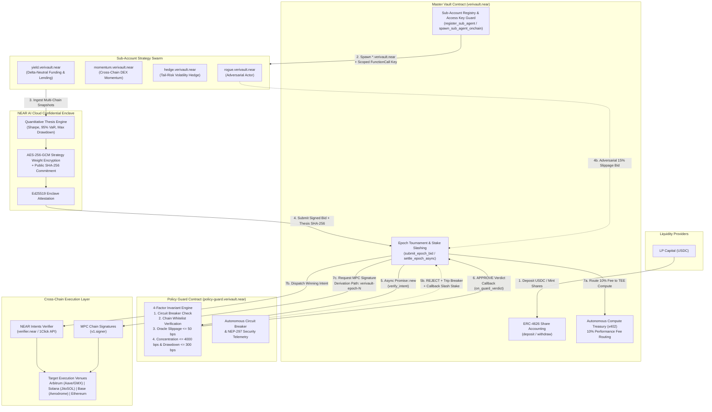
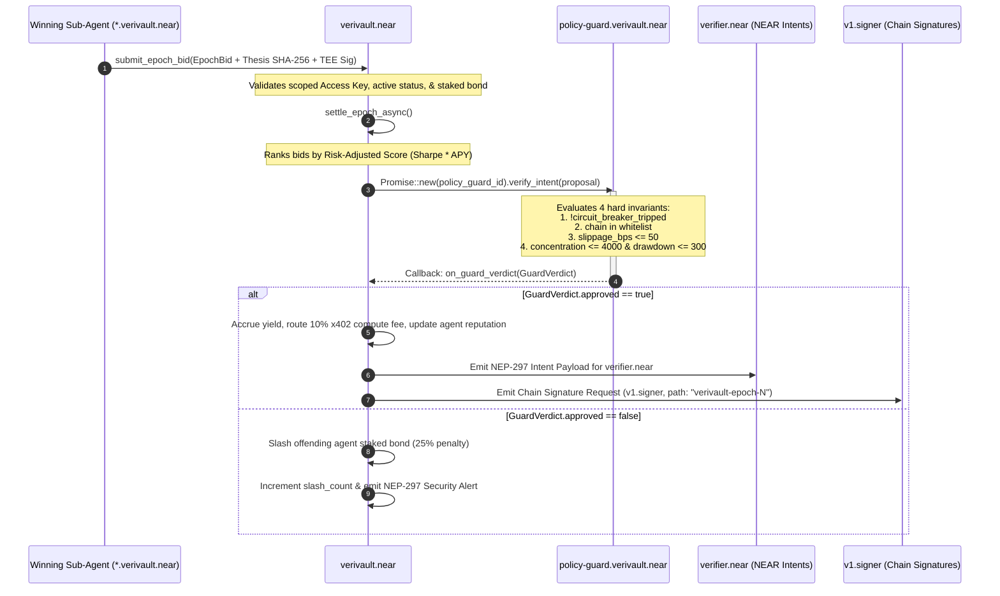

# System Architecture

VeriVault separates **alpha generation** (competing quantitative strategy agents running inside NEAR AI Cloud TEEs) from **custody and risk enforcement** (on-chain NEAR smart contracts, asynchronous cross-contract promises, NEAR Intents, and MPC Chain Signatures).

---

## 1. System Topology

---

## 2. Asynchronous Cross-Contract Settlement Flow

`MasterVaultContract` executes asynchronous cross-contract calls (`near_sdk::Promise`) across isolated contract boundaries:

---

## 3. Core Subsystems

### ERC-4626 Vault & Cross-Chain Settlement (`contracts/master-vault/src/lib.rs`)
- **Share Accounting:** Proportional share minting (`deposit`) and redemption (`withdraw`) backed by USDC reserves.
- **Cross-Chain Settlement:** Approved rebalances construct a cross-chain swap intent targeting `verifier.near` alongside an MPC key derivation payload (`v1.signer`) using epoch-specific derivation paths (`verivault-epoch-{epoch}-{chain}`).
- **x402 Compute Treasury:** Each profitable epoch routes 10% of gross yield into `autonomous_compute_treasury_usdc` to pay for enclave inference and market data feeds.

### Quantitative Thesis Engine & TEE Sealing (`agents/src/thesis-engine.ts`, `agents/src/tee-verifier.ts`)
- **Risk Metrics:** Computes Annualized Sharpe Ratio, Annualized Volatility, Parametric 95% Daily Value-at-Risk (VaR), and Maximum Drawdown from 14-day venue return series.
- **Canonical Commitment:** Serializes the thesis with deterministic key ordering into canonical JSON and hashes it with SHA-256 (`thesis_sha256`).
- **Confidential Weights:** Encrypts proprietary factor weights inside the enclave using `AES-256-GCM` bound to `(epoch, agentId, thesisHash)` AAD and signs the attestation statement with `Ed25519`.

### On-Chain PolicyGuard (`contracts/policy-guard/src/lib.rs`)
Enforces four invariants before any rebalance intent can settle:
1. **Oracle Slippage Cap:** Rejects any swap where `(oracle_expected_out - min_amount_out) / oracle_expected_out > 50 bps` (0.50%).
2. **Single-Asset Concentration Cap:** Blocks rebalances exceeding `4000 bps` (40.00%) exposure to any single asset.
3. **Daily Drawdown Circuit Breaker:** Trips `circuit_breaker_tripped = true` and halts execution if portfolio drawdown exceeds `300 bps` (3.00%).
4. **Chain Whitelist:** Restricts execution to `["ethereum", "arbitrum", "solana", "base"]`.

---

## 4. Threat Model

| Threat Vector | Scenario | Mitigation | Module |
| :--- | :--- | :--- | :--- |
| **Prompt Injection / High-Slippage Swap** | Compromised agent proposes a `$400k` swap at 15% slippage. | `verify_intent` checks bps deviation against `oracle_expected_out`; rejects slippage $> 50\text{ bps}$ and slashes 25% of the agent's bond. | `contracts/policy-guard/src/lib.rs` |
| **Compromised Agent Private Key** | Attacker extracts a sub-agent's Ed25519 key and attempts to call `withdraw`. | Sub-agents hold a `FunctionCall` key scoped strictly to `submit_epoch_bid`; direct asset transfers or withdrawals are rejected by the NEAR runtime. | `contracts/master-vault/src/lib.rs` |
| **Cascading Flash-Crash Drawdown** | Market volatility causes rapid portfolio loss across epochs. | When `current_drawdown_bps > 300`, `PolicyGuard` sets `circuit_breaker_tripped = true`, blocking all subsequent intents until owner reset. | `contracts/policy-guard/src/lib.rs` |
| **Alpha Front-Running** | Observers inspect transaction payloads to copy factor weights. | Strategy factor weights are sealed with `AES-256-GCM` inside the enclave; only the SHA-256 commitment and bounded swap parameters are posted on-chain. | `agents/src/tee-verifier.ts` |
| **Unauthorized Bridge** | Agent attempts to route liquidity to an unapproved chain. | `whitelisted_chains` enforces membership in `ethereum`, `arbitrum`, `solana`, `base`. | `contracts/policy-guard/src/lib.rs` |
