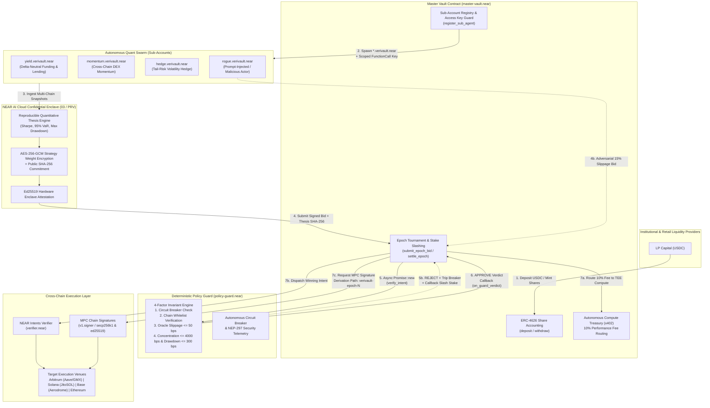
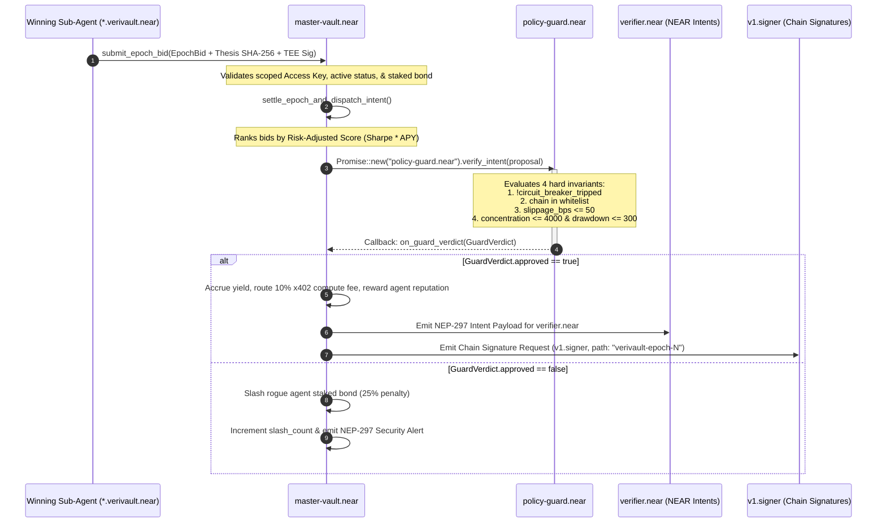

# VeriVault: Deterministic Alpha Vaults — System Architecture

> **Multi-Track NEAR Protocol Flagship Architecture**
> Targeting Tracks: `01 / DFI` (Unstoppable DeFi), `02 / INV` (Investment Thesis), `05 / SWM` (AI Swarms), `06 / SEC` (AI Security & Defense), `03 / PRV` (Privacy & Private AI), and `04 / BUS` (Autonomous Business).

---

## 1. End-to-End System Topology

VeriVault separates **alpha generation** (off-chain competing quantitative AI swarm running inside confidential NEAR AI Cloud TEEs) from **fiduciary custody and risk enforcement** (on-chain deterministic NEAR smart contracts, asynchronous cross-contract promises, NEAR Intents, and MPC Chain Signatures).

---

## 2. Asynchronous Cross-Contract Settlement Flow

Unlike monolithic vaults that simulate checks locally, VeriVault executes genuine asynchronous cross-contract calls (`near_sdk::Promise`) across isolated security domains:

---

## 3. Multi-Track Implementation Mapping

### Track `01 / DFI` — Unstoppable DeFi (Primary)
- **ERC-4626 Deterministic Vault Accounting (`contracts/master-vault/src/lib.rs`)**: Precision share math (`deposit` and `withdraw`) backed by USDC reserves, preventing share inflation attacks and rounding exploits.
- **NEAR Intents & Chain Signatures Settlement**: Upon policy approval, `master-vault` constructs a deterministic cross-chain swap intent targeting `verifier.near` alongside an MPC key derivation payload (`v1.signer`) using epoch-specific derivation paths (`verivault-epoch-{epoch}-{chain}`).

### Track `02 / INV` — Reproducible Investment Thesis
- **Quantitative Thesis Engine (`agents/src/thesis-engine.ts`)**: Processes real multi-chain market series (Arbitrum Aave v3/GMX, Solana JitoSOL, Base Aerodrome) to compute **Annualized Sharpe Ratio**, **Annualized Volatility**, **Parametric 95% Value-at-Risk (VaR)**, and **Maximum Drawdown**.
- **Cryptographic Reproducibility**: Every thesis is serialized with canonical key ordering into a JSON + Markdown artifact and hashed with SHA-256 (`thesis_sha256`). Any external auditor can re-run the engine on the snapshot and verify the exact on-chain hash commitment.

### Track `05 / SWM` — AI Swarms & Sub-Account Coordination
- **Sub-Account Swarm Hierarchy (`contracts/master-vault/src/lib.rs` & `agents/src/swarm-coordinator.ts`)**: Strategy agents operate as dedicated NEAR sub-accounts (`yield.verivault.near`, `momentum.verivault.near`, `hedge.verivault.near`).
- **Scoped Function-Call Access Keys**: Each sub-agent is provisioned with an Ed25519 Function-Call Access Key strictly scoped to `submit_epoch_bid` on `master-vault.near` with zero permission to transfer raw vault assets.
- **Skin-in-the-Game Staking & Slashing**: Agents must bond USDC stake to participate in epoch tournaments. Submitting an intent that violates `policy-guard` invariants triggers automatic stake slashing.

### Track `06 / SEC` — AI Security, Guardrails & Defense
- **Isolated On-Chain Policy Guard (`contracts/policy-guard/src/lib.rs`)**: Enforces immutable quantitative risk invariants before any intent can be dispatched:
  1. **Oracle Slippage Cap**: Rejects any swap where `(oracle_expected_out - min_amount_out) / oracle_expected_out > 50 bps` (0.50%), neutralizing prompt-injection and sandwich-drain attacks.
  2. **Single-Asset Concentration Cap**: Blocks rebalances exceeding `4000 bps` (40.00%) exposure to any single asset.
  3. **Daily Drawdown Circuit Breaker**: Automatically trips `circuit_breaker_tripped = true` and halts vault execution if portfolio drawdown exceeds `300 bps` (3.00%).
  4. **Chain Whitelist**: Restricts execution strictly to audited domains (`["ethereum", "arbitrum", "solana", "base"]`).

### Track `03 / PRV` — Privacy & Private AI (Multiplier)
- **Confidential Strategy Weights (`agents/src/tee-verifier.ts`)**: Inside the simulated NEAR AI Cloud TEE enclave, proprietary strategy factor weights are encrypted using `AES-256-GCM` with an enclave-sealed key. Only the encrypted ciphertext, public risk metrics, and `SHA-256` thesis commitment are posted on-chain—preventing MEV front-runners from reverse-engineering the fund's proprietary alpha.

### Track `04 / BUS` — Autonomous Self-Sustaining Business (Multiplier)
- **x402 Compute & Data Fee Routing (`contracts/master-vault/src/lib.rs`)**: Every profitable epoch automatically routes 10% of accrued performance fees into an autonomous operational treasury (`autonomous_compute_treasury_usdc`) to pay for NEAR AI Cloud TEE inference and market data feeds via x402 settlement receipts.

---

## 4. Threat Model & Formal Security Invariants

| Threat Vector | Attack Scenario | VeriVault Deterministic Mitigation | Enforcing Module |
| :--- | :--- | :--- | :--- |
| **Prompt Injection / Hallucinated Swap** | LLM agent is tricked into swapping \$1M USDC for an illiquid token at 15% slippage. | `verify_intent` computes exact bps deviation against `oracle_expected_out`; rejects any slippage $> 50\text{ bps}$ and slashes the agent's stake. | `contracts/policy-guard/src/lib.rs` |
| **Compromised Agent Private Key** | Attacker steals a sub-agent's Ed25519 key and attempts to call `withdraw` or drain funds. | Sub-agents only hold a scoped **Function-Call Access Key** restricted to `submit_epoch_bid`. Direct asset transfers are impossible at the NEAR runtime level. | `contracts/master-vault/src/lib.rs` |
| **Cascading Flash-Crash Drawdown** | Market volatility causes rapid portfolio loss across epochs. | When `current_drawdown_bps > 300`, `policy-guard` trips `circuit_breaker_tripped = true` in state, blocking all subsequent intents until governance reset. | `contracts/policy-guard/src/lib.rs` |
| **Alpha Front-Running / Strategy Copying** | MEV bots inspect on-chain transaction arguments to front-run rebalance weights. | Raw factor weights are encrypted (`AES-256-GCM`) inside the TEE (`tee-verifier.ts`); only the SHA-256 commitment and bounded intent parameters are revealed on execution. | `agents/src/tee-verifier.ts` |
| **Unauthorized Bridge / Rug Chain** | Rogue agent attempts to bridge vault liquidity to an unverified L2. | `whitelisted_chains` invariant strictly enforces target domain membership (`ethereum`, `arbitrum`, `solana`, `base`). | `contracts/policy-guard/src/lib.rs` |
